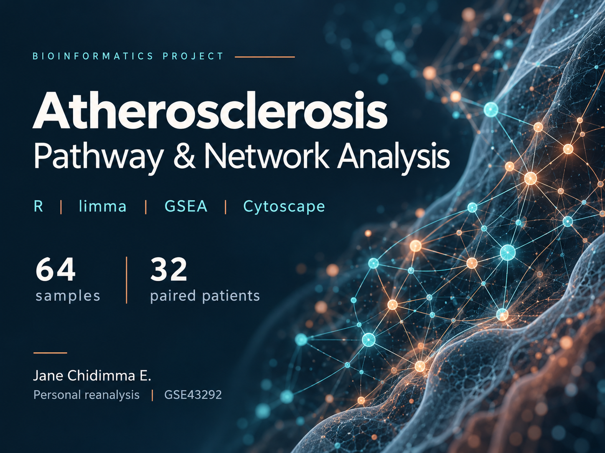

# Atherosclerosis Transcriptomics

## Overview

This project examines gene expression differences between atheroma plaque and paired macroscopically intact carotid tissue using the public GSE43292 dataset.

I developed this reanalysis from my MSc coursework in Network and Pathway Analysis.

## Dataset

GSE43292 contains 64 samples from 32 patients. Each patient contributed one plaque sample and one macroscopically intact tissue sample.

## Analysis

The analysis includes:

- Paired differential expression analysis with limma
- Gene Ontology and KEGG pathway enrichment
- Gene set enrichment analysis
- Protein interaction network analysis using STRING and Cytoscape
- Network ranking using cytoHubba

The differential expression thresholds were a Benjamini–Hochberg adjusted p-value below 0.01 and an absolute log2 fold change above 1.

## Project files

- [Case study](Atherosclerosis_Case_Study.pdf): project overview and findings
- [Methods](METHODS.txt): analysis details
- [Figures](figures/): visual summaries
- [Tables](tables/): exported results

## Code

This repository currently contains the project report and results. Analysis scripts and instructions for running them are not yet included.

## Interpretation

This observational reanalysis explores molecular differences associated with atherosclerotic plaque. It does not establish causal mechanisms or validate clinical biomarkers.

## Data source

[NCBI GEO: GSE43292](https://www.ncbi.nlm.nih.gov/geo/query/acc.cgi?acc=GSE43292)

## Author

Jane Ezeanowai
